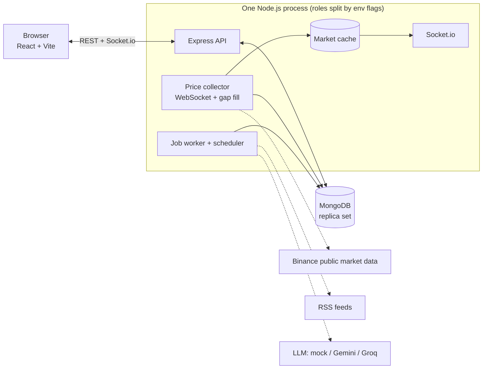

# TradeLab

A **paper-trading platform with a news-reading AI bot**, built with the MERN stack, MongoDB only, live crypto data and free-tier services only.

Users sign up, load fake dollars, and trade BTC, ETH and SOL at **real live prices**. A bot reads recent price candles and crypto headlines every 15 minutes and decides BUY, SELL or HOLD for every user who switched it on, inside strict guardrails.

> **Simulation only.** Money is fake, prices are real. This is a teaching project, not financial advice, and the bot's results are not a promise of anything.

Built as a 15-day, 1-hour-per-day course project for MERN freshers. The focus is **database and system design**, not just CRUD.

---

## Features

- **Money done right:** USD in integer cents, coins in 1e-8 units, `BigInt` for cost maths. No floats are ever stored.
- **Wallet + append-only ledger** with a `reconcile` script that rebuilds balances from the ledger and finds mismatches.
- **Safe trading:** conditional atomic update, MongoDB transaction and idempotency keys. Ten parallel buys with money for one: exactly one wins.
- **Live market data:** Binance public WebSocket for prices and 1-minute candles, with reconnect, watchdog and automatic gap backfill.
- **News ingestion:** free RSS feeds, URL-hash dedupe, coin tagging, crude sentiment.
- **Job queue in MongoDB:** atomic claim, retry with backoff, slot-based dedupe, stuck-job recovery.
- **AI bot done safely:** one LLM call per cycle shared by all users, JSON validated with zod, per-user guardrails, full audit trail.
- **Analytics:** hourly candle rollups with `$dateTrunc` and `$merge`, leaderboard with `$lookup`, buy-and-hold benchmark.
- **React dashboard:** live prices over Socket.io, trade forms with idempotency keys, bot decision log, leaderboard.

## Architecture



### Bot pipeline

1. Collect facts from MongoDB (candles, indicators, headlines).
2. Build the prompt (headlines are _data_, never instructions).
3. Call the LLM **once**.
4. Validate the JSON with zod. Bad output means everyone HOLDs.
5. Save the signal (what the model saw and said).
6. Fan out one job per user.
7. Apply guardrails (confidence, risk cap, cooldown, balance, $10 minimum).
8. Execute through the same safe `executeTrade` as manual trades.
9. Save a decision log with what was asked, what was done and why.

### Collections

`users`, `wallets`, `ledger_entries`, `orders`, `candles`, `news`, `jobs`, `bot_signals`, `bot_decisions`.

Index highlights: unique compound `(symbol, interval, openTime)` on candles, partial TTL on 1m candles (30 days), unique `(userId, idempotencyKey)` on orders, sparse unique `dedupeKey` on jobs, multikey `symbols` on news, partial index on `users.botEnabled`.

## Tech stack

| Layer    | Tools                                                                                      |
| -------- | ------------------------------------------------------------------------------------------ |
| Backend  | Node.js 22, Express 5, Mongoose 8, zod 4, JWT, bcryptjs, express-rate-limit, ws, Socket.io |
| Frontend | React 19, Vite, socket.io-client                                                           |
| Database | MongoDB (replica set, needed for transactions)                                             |
| Optional | Redis pub/sub for splitting the collector into its own process                             |

## Free services used

| Need               | Service                                                      | Note                                            |
| ------------------ | ------------------------------------------------------------ | ----------------------------------------------- |
| Database           | MongoDB Atlas M0, or local Docker                            | Atlas free is 512 MB, so TTL and rollups matter |
| Prices and candles | Binance public market data (`data-api.binance.vision`)       | No API key                                      |
| News               | Public RSS feeds                                             | Feed URLs can change                            |
| LLM                | `mock` (default), Google Gemini free tier, or Groq free tier | Limits change, check the provider               |
| Hosting            | Render free web service + any free static host               | Render free sleeps after about 15 minutes idle  |

Free-tier limits change often. Re-check the providers' pages before relying on any number.

## Quick start

**Requirements:** Node.js 22+, Docker (or an Atlas free cluster).

```bash
# 1. MongoDB (single-node replica set) and Redis
docker compose up -d
docker compose ps            # wait for mongo to be (healthy)

# 2. Server
cd server
cp .env.example .env         # set JWT_SECRET to a long random string
npm install
npm run indexes              # build all indexes
npm run backfill -- 2        # download 2 days of 1m candles
npm run dev                  # http://localhost:4000

# 3. Client (new terminal)
cd client
cp .env.example .env
npm install
npm run dev                  # http://localhost:5173
```

Check it works: `curl localhost:4000/health` returns `{"ok":true}`.

The bot runs with `LLM_PROVIDER=mock` by default. That needs no API key and no internet. To use a real model, set `LLM_PROVIDER=gemini` (or `groq`) and the matching key in `server/.env`.

## Environment variables (`server/.env`)

| Variable                          | Default                           | Notes                                                             |
| --------------------------------- | --------------------------------- | ----------------------------------------------------------------- |
| `MONGO_URI`                       | required                          | Local: `mongodb://localhost:27017/tradelab?directConnection=true` |
| `JWT_SECRET`                      | required                          | At least 16 characters                                            |
| `PORT` / `CLIENT_ORIGIN`          | `4000` / `http://localhost:5173`  | CORS allows only `CLIENT_ORIGIN`                                  |
| `SYMBOLS`                         | `BTCUSDT,ETHUSDT,SOLUSDT`         | Binance symbols                                                   |
| `BINANCE_REST` / `BINANCE_WS`     | public market-data hosts          | No key needed                                                     |
| `RUN_COLLECTOR` / `RUN_WORKERS`   | `true` / `true`                   | Process roles                                                     |
| `REDIS_URL`                       | empty                             | Optional                                                          |
| `LLM_PROVIDER`                    | `mock`                            | `mock`, `gemini` or `groq`                                        |
| `GEMINI_API_KEY` / `GEMINI_MODEL` | empty / `gemini-2.5-flash-lite`   | Check AI Studio for current models                                |
| `GROQ_API_KEY` / `GROQ_MODEL`     | empty / `llama-3.3-70b-versatile` | Check the Groq console                                            |
| `BOT_INTERVAL_MIN`                | `15`                              | Bot cycle length                                                  |

Never commit `.env`.

## Scripts (`server/`)

| Command                               | What it does                                                                 |
| ------------------------------------- | ---------------------------------------------------------------------------- |
| `npm run dev` / `npm start`           | Run the server (watch mode / normal)                                         |
| `npm test`                            | Unit tests (no database or internet needed)                                  |
| `npm run test:integration`            | Integration tests, needs `MONGO_URI_TEST` pointing at an empty test database |
| `npm run indexes`                     | Build and list all indexes                                                   |
| `npm run backfill -- <days> [SYMBOL]` | Download 1m candles, then roll up hourly candles                             |
| `npm run reconcile`                   | Compare every wallet with its ledger (exit code 1 on mismatch)               |
| `npm run race`                        | Demo: naive trade vs safe trade under parallel attack                        |
| `npm run explain`                     | Demo: index scan vs collection scan numbers                                  |
| `npm run seed:users`                  | Five demo users (password `demo12345`) with a few trades                     |
| `npm run news:once`                   | Fetch all RSS feeds once                                                     |
| `npm run bot:once`                    | Run one bot cycle now                                                        |

## API

All error responses look like `{ "error": { "code", "message", "details" } }`.

| Method and path              | Auth                    | Purpose                                    |
| ---------------------------- | ----------------------- | ------------------------------------------ |
| `GET /health`                | no                      | 200 if MongoDB is connected                |
| `POST /api/auth/register`    | no                      | Create user and wallet                     |
| `POST /api/auth/login`       | no                      | Get a JWT                                  |
| `GET /api/auth/me`           | yes                     | Current user and wallet                    |
| `PATCH /api/auth/me/bot`     | yes                     | Bot on/off and risk level                  |
| `POST /api/wallet/deposit`   | yes + `Idempotency-Key` | Load fake money (`amountUsd` as a string)  |
| `GET /api/wallet/ledger`     | yes                     | Ledger, keyset pagination                  |
| `POST /api/trades`           | yes + `Idempotency-Key` | Market order. The server decides the price |
| `GET /api/trades`            | yes                     | My orders                                  |
| `GET /api/market/prices`     | no                      | Latest cached prices                       |
| `GET /api/market/candles`    | no                      | `?symbol&interval&limit`                   |
| `GET /api/market/news`       | no                      | `?asset&limit`                             |
| `GET /api/portfolio`         | yes                     | Cash, positions, P&L                       |
| `GET /api/leaderboard`       | yes                     | Top 20 by return, plus 7-day buy-and-hold  |
| `GET /api/bot/decisions`     | yes                     | My bot decision log                        |
| `GET /api/bot/signal/latest` | yes                     | Last shared signal                         |

## Project structure

```
tradelab/
├── docker-compose.yml        MongoDB (replica set) + Redis for local development
├── server/
│   ├── src/
│   │   ├── server.js  app.js
│   │   ├── config/           validated env, DB connection
│   │   ├── lib/              pure helpers: money, indicators, guardrails, klines, news utils, mock LLM
│   │   ├── models/           Mongoose schemas and indexes
│   │   ├── middleware/       auth, validation, errors, rate limits
│   │   ├── routes/           thin HTTP layer
│   │   ├── services/         trading, wallet, candles, collector, news, jobs, bot
│   │   └── scripts/          backfill, reconcile, race demo, explain demo, ...
│   └── tests/                unit/ and integration/
└── client/                   React + Vite dashboard
```

## Design decisions worth reading

1. **Integers for money.** `0.1 + 0.2 !== 0.3`, and a wallet cannot afford that.
2. **Wallet plus append-only ledger plus reconcile.** The balance is fast to read; the ledger explains it and can rebuild it.
3. **Three protections for every trade.** A conditional atomic update stops overspending, a transaction stops half-finished trades, and an idempotency key stops double trades on retry.
4. **The server decides the price**, from a fresh cache. No fresh price means no trade.
5. **Tiered retention.** 1-minute candles expire after 30 days; hourly rollups stay. This keeps the project inside Atlas free storage.
6. **Gap backfill on every reconnect**, so a sleeping free-tier server loses no history.
7. **Job queue on MongoDB** with an atomic claim and slot-based `dedupeKey`, so three servers still run one job per slot. Handlers are idempotent because delivery is at-least-once.
8. **The LLM is an untrusted component.** One call per cycle, schema-validated output, guardrails applied per user in deterministic code, and a full audit trail.

## Testing and honest status

- `npm test` runs the unit tests: money maths, indicators, guardrails, parsing, index declarations, API validation paths, retry logic, and the collector's reconnect against a fake Binance server.
- `npm run test:integration` covers parallel trades, rollback, idempotency, the job queue, rollups, the leaderboard and bot fan-out. It needs a real MongoDB replica set.
- Run the integration suite and the demo scripts (`race`, `explain`, `bot:once`) on your own MongoDB before teaching from this. Live Binance, RSS and LLM calls depend on your network and keys.

## Deploying on free tiers

1. **Database:** create an Atlas M0 cluster, add a user, allow network access, copy the `mongodb+srv://` string, run `npm run indexes` once.
2. **API:** a Render free web service with root `server`, build `npm install`, start `npm start`. Set `MONGO_URI`, `JWT_SECRET`, `CLIENT_ORIGIN`, `NODE_ENV=production`, plus LLM settings. Health check path: `/health`.
3. **Client:** any static host with root `client`, build `npm run build`, publish `dist`. Set `VITE_API_URL` to the API URL before building.

Render free sleeps when idle, so the collector and bot only run while the service is awake. On wake, the gap fill and scheduler catch up.

## Known limits

- Fake money and simulated fills at the last price: no order book, slippage or fees.
- News sentiment is a crude keyword score; the LLM does the real reading.
- JWT is stored in `localStorage` for simplicity. Prefer httpOnly cookies in production.
- The in-memory rate limiter and market cache are per process. Use Redis if you run several servers.

## License

Add a license of your choice (for example MIT) before publishing.
